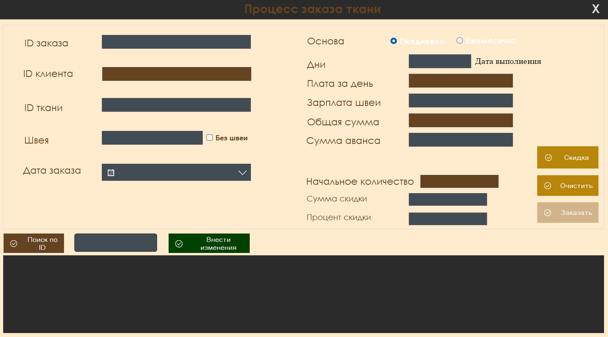

# Sewing Factory Management

Student Windows desktop project using C#, WinForms and MySQL. The screens illustrate login and record management for orders, products, customers and staff.

- [Application files](project-files)
- [Database files](database)
- [Interface screenshots](src)

The repository is a legacy coursework snapshot. To explore it locally, use a separate test database and review the database import and connection settings first.
