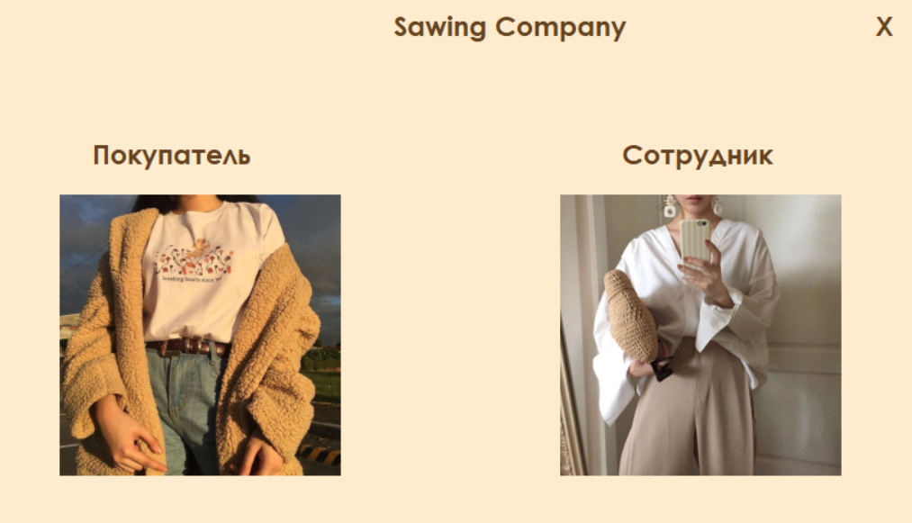
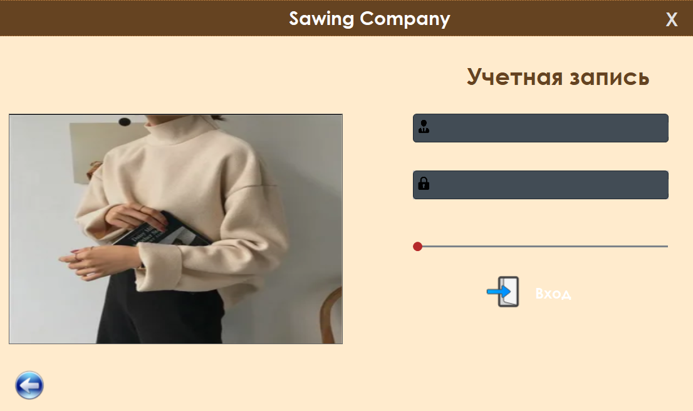
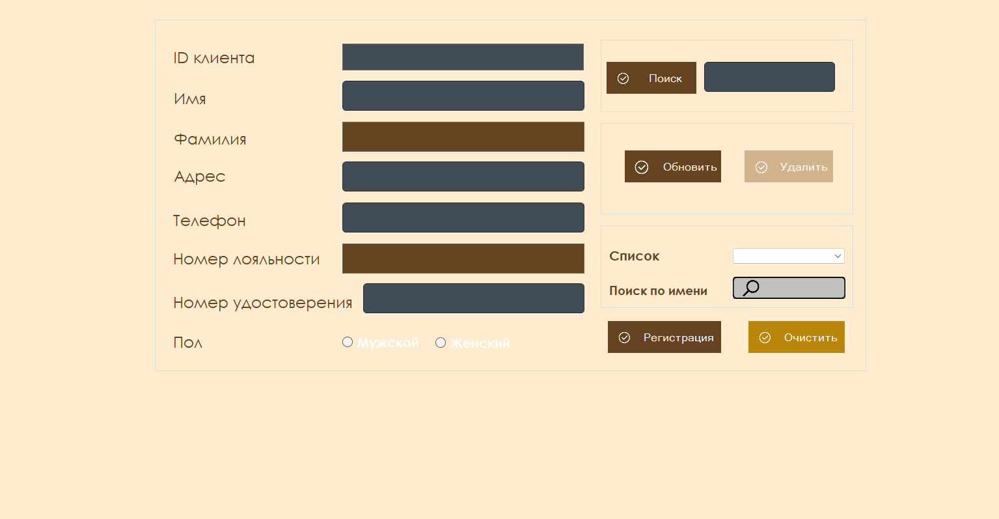
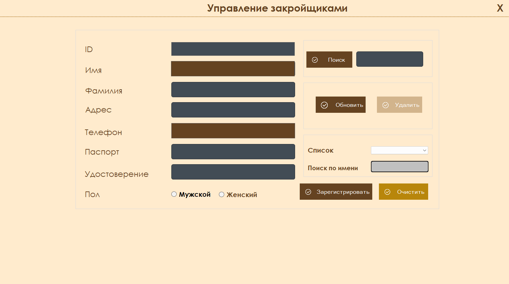
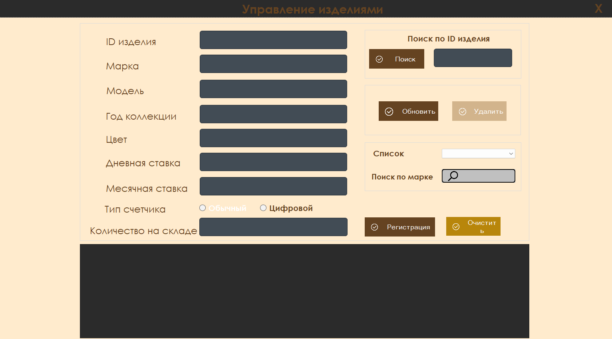

---
<div align="center">


</div>

# 🧵 Sewing Factory Management System (SFMS)

<p align="center">
  <strong>Комплексная система управления швейной фабрикой для оптимизации производственных процессов</strong>
</p>

<p align="center">
  Полнофункциональное WinForms-приложение для управления заказами, клиентами, персоналом и отчетностью швейного производства. Идеально подходит для небольших и средних предприятий текстильной промышленности.
</p>

---

## 📖 Обзор системы

<p align="center">
  
</p>

<p align="center">
  <em>Выбор типа учетной записи при входе в систему</em>
</p>

---

## ✨ Основные возможности

<div align="center">

| 🏢 Модуль                                              | 📋 Описание                                                               | 🎯 Цель                                              |
| :----------------------------------------------------------- | :-------------------------------------------------------------------------------- | :------------------------------------------------------- |
| **👥 Управление клиентами**         | Регистрация, редактирование, поиск клиентов | Организация клиентской базы     |
| **✂️ Управление персоналом**     | Учёт закройщиков и их специализаций                | Оптимизация рабочего процесса |
| **🧥 Управление ассортиментом** | Каталог изделий с характеристиками                 | Управление продукцией                |
| **📦 Обработка заказов**               | Создание и отслеживание заказов                       | Полный цикл производства           |
| **📊 Аналитика прибыли**               | Отчёты по доходам и расходам                              | Финансовый контроль                    |
| **🔔 Уведомления**                          | Напоминания о сроках                                            | Оперативное реагирование          |
| **⚙️ Администрирование**            | Настройки и резервное копирование                   | Системное управление                  |

</div>

---

## 🚀 Демонстрация интерфейса

### 🔐 Форма входа в систему

<p align="center">
  
</p>
<p align="center">
  <em>Форма аутентификации с многоуровневым доступом</em>
</p>

---

## 🏗 Архитектура системы

* **`project-files/Garment_Factory_Management_System`** – основной WinForms-проект на C# (.NET Framework 4.8).
* **`database/garmentfactory.sql`** – дамп структуры и данных базы данных MySQL.
* **`windows-service-for-garment-factory`** – вспомогательный Windows-сервис для мониторинга конфигурации и безопасности (опционально).

---

## 🛠 Инструкция по развертыванию

### 1. Настройка базы данных MySQL

Создайте пустую базу данных с именем `garmentfactory` и импортируйте дамп:

```bash
mysql -u root -p garmentfactory < database/garmentfactory.sql
```

### 2. Подготовка среды разработки

* Установите **.NET Framework 4.8 SDK**.
* Установите **MySQL Connector/NET**.
* Откройте решение `Garment_Factory_Management_System.sln` в Visual Studio.

### 3. Сборка и запуск

* Выполните восстановление NuGet-пакетов (проверьте `packages.config`).
* Соберите проект в конфигурации `Release` или `Debug`.
* Точка входа: форма `accountType`.

---

## 🔐 Тестовые данные для входа

<div align="center">

| Роль                                | Логин | Пароль |
| --------------------------------------- | ---------- | ------------ |
| **👑 Администратор** | `kuna`   | `123`      |
| **👷 Сотрудник**         | `guna`   | `guna123`  |

> **Примечание:** Параметры подключения к БД и полные списки учетных записей зафиксированы в тех. документации `tz.txt`.

</div>

---

## 💼 Модули управления (Скриншоты)

<div align="center">
 
<br>
<em>Клиентская база и управление персоналом</em>
</div>

<div align="center">
 
<br>
<em>Ассортимент продукции и журналы заказов</em>
</div>

---

## 🧩 Технические особенности

* **Data Access Layer:** Класс `CRUDQueryClass` инкапсулирует логику CRUD-операций с MySQL.
* **XML Configuration:** Все системные настройки, скидки и статусы пользователей хранятся в `%AppData%/GFMS` для обеспечения мобильности.
* **Security Service:** Выделенный Windows-сервис защищает критические файлы конфигурации от случайного удаления пользователем.

---

## 📝 Статус и дорожная карта

Проект успешно перенесен и локализован под задачи легкой промышленности.

**Рекомендации по развитию:**

* [ ] Миграция на **.NET 8+** — для повышения производительности.
* [ ] Реализация REST API для интеграции с веб-интерфейсом.
* [ ] Внедрение системы логирования (NLog/Serilog).

---

## 🤝 Обратная связь и контакты 👨‍💻

### 📧 Email: **IMgalaxy.light@yandex.com**

---

<div align="center">

**Сделано с ❤️ от [ygalaxyy](https://github.com/ygalaxyy)**

</div>
